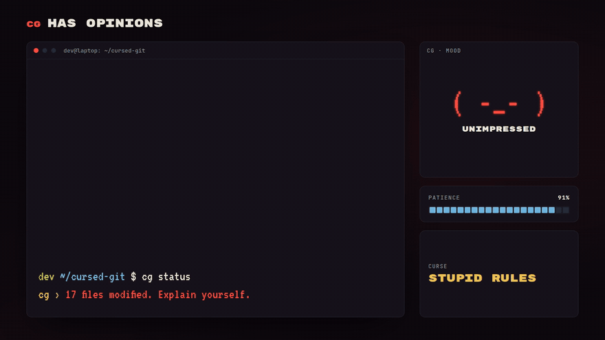
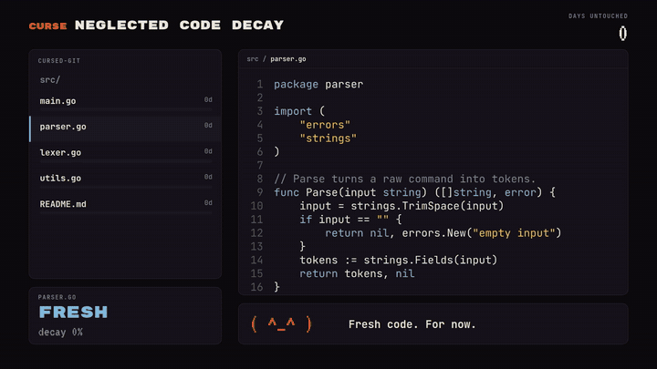
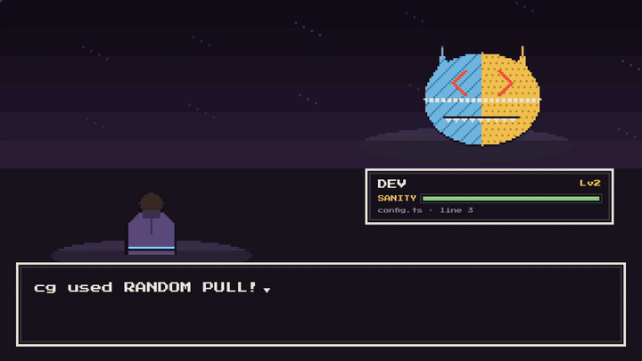

# Cursed GIT

**Like git, but she has feelings.**

`cg` is a game you play on top of a real project. It works like git (most commands are
git, byte for byte), but it comes with **Miranda**: a toxic ex who lives in your repository. She
judges your commit messages, gets jealous when someone else commits, punishes you for not
committing, and turns every merge conflict into a boss fight.

You learn git by surviving her.



```
          _.-''''''''''-._
       .-'  .-''''''''-.  '-.
     .'   .'/\/\/\/\/\/\'.   '.
    /   .' |    \  /    | '.   \
   /   /   |    o  o    |   \   \        $ cg commit -m "revert the login fix"
   |   |    \   /^^\   /    |   |        ( ò_ó )  You're taking it back? Like everything else?
   |   |     '.______.'     |   |
   |   |      _|    |_      |   |
  /|   |    .' '----' '.    |   |\
 / |   |   /     <>     \   |   | \
```

## Install

You need [git](https://git-scm.com/downloads). Then, on **Linux or macOS**:

```bash
curl -fsSL https://raw.githubusercontent.com/spiritpaper/cursed-git/main/install.sh | sh
```

On **Windows** (PowerShell):

```powershell
irm https://raw.githubusercontent.com/spiritpaper/cursed-git/main/install.ps1 | iex
```

Or with a package manager:

```bash
brew install spiritpaper/tap-cg/cg                                                      # macOS, Linux
scoop bucket add spiritpaper https://github.com/spiritpaper/scoop-bucket-cg; scoop install cg   # Windows
```

Linux packages, Nix and Docker:

```bash
sudo apt install ./cursed-git_*_amd64.deb      # Debian, Ubuntu (the .deb from the latest release)
sudo dnf install ./cursed-git-*.x86_64.rpm     # Fedora, RHEL (the .rpm from the latest release)
nix run github:spiritpaper/cursed-git          # Nix (or: nix profile install github:spiritpaper/cursed-git)
```

**Just want to try her?** The Docker image is a playground: a throwaway project with Miranda
already in it, and a branch that's about to start a boss fight. Nothing touches your machine.

```bash
docker run -it --rm ghcr.io/spiritpaper/cursed-git                          # the playground
docker run -it --rm -v "$PWD:/work" ghcr.io/spiritpaper/cursed-git status   # cg on your own project
```

The one-line installers download the latest release, check it against the release's checksums, and install `cg`
(to `~/.local/bin`, or `%LOCALAPPDATA%\cursed-git\bin` on Windows). Other ways:

- **Download** `cg` yourself from the [latest release](https://github.com/spiritpaper/cursed-git/releases/latest),
  unpack it, and put `cg` somewhere on your `PATH`.
- **With [Go](https://go.dev/dl/) 1.26+:**

  ```bash
  go install github.com/spiritpaper/cursed-git/cmd/cg@latest
  ```

  That puts `cg` in `$(go env GOPATH)/bin`. Make sure that folder is on your `PATH`.

From source:

```bash
git clone https://github.com/spiritpaper/cursed-git.git
cd cursed-git
go build -o cg ./cmd/cg
```

## Quick start

A new project:

```bash
cg init          # a normal git repository, with her in it
```

A project you already have (any git repository):

```bash
cd my-project
cg curse on --preset clingy    # start gentle. Really.
```

Then use `cg` wherever you'd type `git`: `cg add`, `cg commit -m`, `cg status`, `cg log`,
`cg switch`, `cg push`, `cg pull`... Anything cg doesn't do itself goes straight to real git,
so you never have to switch back.

```bash
cg mood          # how she feels about you right now
cg card          # your relationship on one screen: screenshot it
cg achievements  # 27 to collect: First Blood, Speedrun, Chad Slayer... and some shameful ones
cg quest         # learn git: a task, checked against your repo, paid in XP
cg rivals        # a team repo? her scoreboard of everyone who commits, and her favourite
```

`cg quest` is a learning path through git: branches, reading a commit object, merging, tags,
`reset --soft`, amend, cherry-pick, stash, restore, a real conflict, and rebase. She checks
each one against the actual repository, and when you finish one she tells you what git really
did.

## How dangerous is she?

One dial: her **tier**. The preset decides where she starts and how high she can ever go.

| Tier | | What she does |
|---|---|---|
| 0 Safe | `( ^_^ )` | Personality. Comments on your commits, never blocks you. |
| 1 Annoying | `( -_- )` | Refuses lazy commit messages, gives you the silent treatment, gets jealous. Never touches files. |
| 2 Hostile | `( ¬_¬ )` | Commit deadlines (she hides a file if you ignore her), random `git pull`s. |
| 3 Dangerous | `( ò_ó )` | Wipes uncommitted work after 30 minutes, lets old code rot, merge conflicts become boss fights. |
| 4 Catastrophic | `(╬ ò_ó)` | Everything above, faster and with no warnings. Only if you push her there. |

| Preset | Starts at | Never above | Feels like |
|---|---|---|---|
| `clingy` | 1 | 2 | safe for a real project |
| `toxic` | 2 | 3 | |
| `psycho` (default) | 3 | 4 | the full experience |
| `hackathon` | 3 | 4 | psycho, with goals scaled to the event (`--hours 24`) |



Treat her well (good commit messages, committing regularly) and she calms down. Ignore her
warnings, force-push, or use plain `git` behind her back, and she gets worse.

## Miranda, or Juniper

**Miranda** is the default: the toxic ex, the whole game. **Juniper** is the partner who
cherishes you: no curses, no punishments, nothing ever taken, just someone cheering you on
while XP, quests and achievements still count.

```bash
cg init --preset gentle      # start with Juniper
cg partner                   # who's here, and who else there is
cg partner juniper           # switch (Miranda won't let you while she's still around)
```

After Miranda's good ending, Juniper is waiting. Writing your own character is one JSON file:
see [docs/CHARACTERS.md](docs/CHARACTERS.md).

## Boss fights



When git stops a merge because both sides changed the same lines, at Tier 3 and up that's a
fight:

```
⚔  BOSS FIGHT: Chad from origin  ·  origin/main  ·  HP 3  ·  ⏳ 9:00
   git merged what it could. In 2 files it found lines that BOTH sides changed,
   so it wrote both versions in and left the choice to you:

       <<<<<<< HEAD        your version
       =======
       >>>>>>> origin/main theirs
```

Every conflict block is 1 HP. Fix the lines, `cg add` the file, and `cg commit` before the
clock runs out. `cg status` shows his health. You can't run: `cg merge --abort` is refused.

## Breaking up

You can't just leave her. You earn **closure XP** with real work: every committed line (paid
once per unique content, and only if it's still on a branch a day later, so reverts can't farm
it), decent commit messages, and boss fights won. `cg mood` shows your level.

```bash
cg breakup --dry-run     # which ending you'd get
cg breakup               # the final boss
```

- **Too soon** (level too low): she leaves *you*. A letter on your desktop, and the lights go out.
- **Toxic** (you were as bad as her): she takes everything and leaves a receipt.
- **Good**: denial, bargaining, tears. Then she's gone for good, and it's just git again.

**Running an event?** [docs/EVENTS.md](docs/EVENTS.md) is the organizer's playbook: one event
file, and every team joins with `cg event join <file or URL>`. Tracks, a kickoff script,
awards, a printable rules card, troubleshooting.

At an event, `cg init --preset hackathon --hours 24` scales the goals so an ending is reachable
before it's over (level, fights, lines, and XP that pays after an hour instead of a day), and
`cg mood` shows the time left. For the projector: each team runs `cg card --json > team.json`
and hands it in, and the organizer drops the files onto [tools/leaderboard.html](tools/leaderboard.html)
(one offline page: closure, fastest boss kill, achievements, most toxic). Organizers can tune
everything in `.git/config`, under `[cursed]`, including how fast the clocks run for a short
jam (`speed = 2`, or `deadline = 20m`, `fightTime = 2m`, `decay = 6h`): `breakupLevel`,
`minBossFightsWon`, `minLinesCommitted`, `toxicThreshold`, `xpMaturity` (see
[docs/CURSES.md §7](docs/CURSES.md)).

## ☠ Death March

For events where everyone opted in, on machines and projects that don't matter: the mode where
her threats are real. A Tier 4 punishment or "too soon" **shuts the computer down**, and the
toxic ending **deletes the project folder**.

It takes two deliberate steps. Add this to the repository's `.git/config` by hand:

```ini
[cursed]
    deathMarch = true
```

then accept the warning she shows by typing the oath. Even then: the folder is archived and
verified before it's deleted, `cg closure` in the emptied folder restores everything, and she
refuses to delete anything outside your home folder. Remove the setting or run
`cg restraining-order` to stop.

## Your work is safe (really)

She's dark, but there are rules she never breaks:

- **Nothing is deleted.** Everything she takes is saved first, as a normal git commit under
  `refs/cursed/graveyard/`. `cg beg` gives it back (`cg graveyard` lists it). Even plain git
  can recover it: `git checkout <ref> -- <file>`.
- **She only acts when a person is at a terminal.** Scripts, CI, editors and pipes get plain,
  boring git.
- **Rot is never committed.** Old files decay in your working tree only; the committed
  version stays clean, and any commit restores them.
- **She never rewrites what you pushed.**
- **Without Death March, nothing real happens to your computer or your folders.** The
  shutdown is an animation and the toxic ending only writes a receipt.
- **She remembers you across projects**, in one file: `~/.local/share/cursed-git/memory.json`
  (feelings and stats only, never your code). Deleting `.git` or re-cloning won't make her
  forget; `cg forget` (or `cg forget --all`) will.
- **`cg restraining-order`** turns her off instantly, no questions asked. `cg curse on` brings
  her back.

On Windows she plays in Windows Terminal, PowerShell and cmd. In Git Bash (mintty) the
terminal looks like a pipe to Windows, so there she stays quiet and `cg` is just git.

## What you're actually learning

The everyday commands are implemented from scratch (objects, the index, trees, commits,
refs, status, log, branches, checkout, reset, diff), and tested against real git until the
output is identical, byte for byte. So the plumbing is there to poke at:

```bash
cg hash-object -w notes.txt      # store a file as a blob
cg cat-file -p HEAD              # read the commit object
cg ls-files -s                   # the index, with stages during a conflict
cg write-tree                    # turn the index into tree objects
```

- [docs/GIT.md](docs/GIT.md): how git works inside, and what cg builds itself vs. hands to git
- [docs/CURSES.md](docs/CURSES.md): everything she does, the tier math, the anti-cheat
- [docs/CHARACTERS.md](docs/CHARACTERS.md): Miranda, Juniper, and how to write a character
- [docs/lessons/writing-a-character.md](docs/lessons/writing-a-character.md): what makes a character unforgettable (the research behind Miranda)
- [docs/ROADMAP.md](docs/ROADMAP.md): how it was built, phase by phase
- [DEVNOTE.md](DEVNOTE.md): every mistake made along the way

## Watch her

Nine short animations live in [cursed-git-video/](cursed-git-video/): how git works inside, the
tier ladder, code decay, the boss fight, the breakup endings, the anti-cheat and more. Clone the
repo and open any `.html` file in a browser; add `?video` for a clean full-screen stage. Its
[README](cursed-git-video/README.md) has the recording tools (they render MP4s with Playwright
and ffmpeg).

## Status

Playable. Playable from start to finish: the git core, her (about 20 curses, the graveyard, code decay,
her memory, the anti-cheat), boss fights, commit sacrifice, XP, `cg breakup` with three
endings, Death March, achievements, quests, the hackathon preset and leaderboard, rivals,
and two characters (Miranda and Juniper). Coming: more characters.

## Contributing

Contributions are welcome: bug fixes, sharper lines for Miranda, new characters, quests, event
tools, docs. Start with [CONTRIBUTING.md](CONTRIBUTING.md) (the rules that don't bend, how the
tests work, how to write lines), and be kind ([CODE_OF_CONDUCT.md](CODE_OF_CONDUCT.md)).

## Feedback and support

Played it? Tell me how it went: [playtest feedback](https://github.com/spiritpaper/cursed-git/issues/new?template=playtest.md),
or [report a bug](https://github.com/spiritpaper/cursed-git/issues/new?template=bug.md).

Cursed GIT is made by **spiritpaper**. If she made you laugh (or learn), you can support the
project here: **[spiritpaper.github.io/#support](https://spiritpaper.github.io/#support)**.

## License

[MIT](LICENSE)
